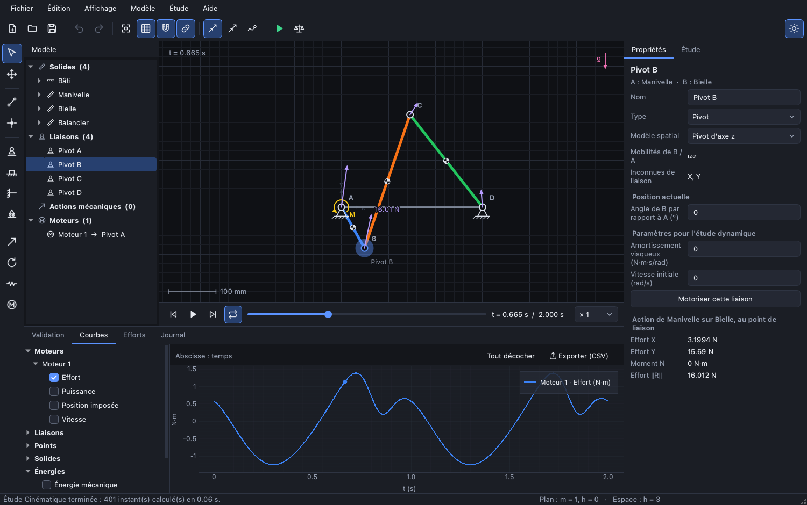
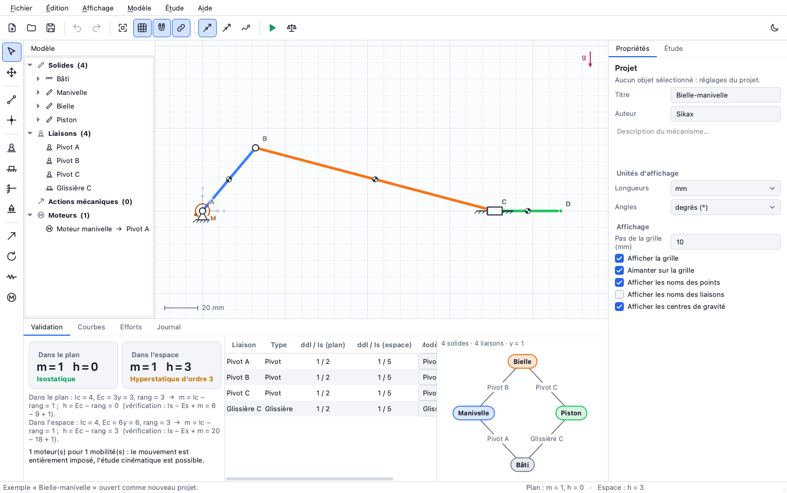

# Sikax

Sikax est une application d'ingénierie mécanique écrite en Python. Elle permet de
**dessiner** le schéma cinématique d'un mécanisme plan, de **valider** sa mobilité et son
isostatisme, puis de **calculer** sa cinématique, sa statique (PFS) et sa dynamique (PFD),
et d'en **tracer** les résultats.



| Besoin du cahier des charges | Dans Sikax |
|---|---|
| Schéma cinématique 2D (solides, points, liaisons) | Outils de dessin à la souris, arbre du modèle, panneau de propriétés |
| Thème sombre | Thème par défaut ; bouton lune/soleil de la barre d'outils, menu Affichage ou `Ctrl+T` pour passer au thème clair. Le choix est mémorisé |
| Enregistrer / ouvrir, lecture robuste | Format `.sikax` (JSON), lecteur à diagnostics complets, écriture atomique |
| Validation de l'isostatisme | Panneau *Validation* : mobilité `m`, hyperstatisme `h`, graphe des liaisons, dans le plan **et** dans l'espace |
| Actions mécaniques, inertie | Forces, couples, ressorts-amortisseurs, pesanteur ; masse, centre de gravité, moment d'inertie |
| Configuration initiale et mouvement | Outil *Manipuler*, position des liaisons, moteurs à lois de mouvement |
| Cinématique, torseurs par PFS/PFD | Trois études : statique, cinématique (dynamique inverse), dynamique |
| Courbes | Panneau *Courbes* : tableau de bord (position, vitesse, accélération, efforts, couples, énergie) ou courbes au choix ; animation ; export **Excel** (`.xlsx`) et image |
| Solveur stable, points morts | Intégrateurs SciPy (Radau par défaut, BDF, LSODA…), efforts bornés et points morts franchis, emballement détecté et expliqué |
| Cercles, cames, engrenages | Outil *Cercle* (disque, came excentrique), contact came-poussoir (pointe, galet, plateau), engrenages extérieur, intérieur, pignon-crémaillère avec rendement |
| Prise en main | Fenêtre de bienvenue, tutoriel animé (`F1`), fiches de cours et boutons « ? » (`Maj+F1`) |
| Photo d'un schéma | Import d'une photo en fond, étalonnage par deux clics, détection automatique des barres, disques et pivots (OpenCV) |
| Langue | Français par défaut, anglais fourni, fichiers `locales/*.json` |
| Distribution Windows | Dossier `Sikax.exe` + `runtime/` + `locales/` + `resources/` par PyInstaller |

## Télécharger Sikax pour Windows

La version prête à l'emploi est sur la page des versions :
**<https://github.com/wiokitobubu/sikax/releases/latest>**

Téléchargez l'archive `Sikax-…-windows.zip`, décompressez-la et lancez `Sikax.exe`. Il
n'y a rien à installer. Le reste de cette page s'adresse à qui veut lire ou modifier le
code.

## 1. Installation et lancement (VS Code)

Il faut Python 3.9 ou plus récent (testé en 3.9 et 3.13).

```powershell
# dans le dossier du projet (celui qui contient main.py)
python -m venv .venv
.venv\Scripts\activate
pip install -r requirements.txt
python main.py
```

Sous macOS ou Linux, la deuxième ligne devient `source .venv/bin/activate`.

Dans VS Code : *Fichier → Ouvrir le dossier*, choisir l'interpréteur `.venv`, puis `F5`
(configuration « Sikax »). Trois configurations de lancement et quatre tâches sont fournies
dans `.vscode/`.

```text
python main.py projet.sikax      ouvre un projet
python main.py --theme clair     démarre en thème clair
python main.py --langue en       démarre en anglais
python main.py --autotest        vérifie l'installation sans ouvrir de fenêtre
```

## 2. Prise en main

Au premier lancement, Sikax demande : *Es-tu nouveau sur Sikax ?* Répondre oui lance le
**tutoriel** : la fenêtre s'assombrit, l'outil présenté est mis en lumière, et un panneau
montre une courte animation, deux ou trois consignes et les boutons *Suivant* et
*Compris*. On le relance à tout moment par *Aide → Tutoriel* (`F1`).

Le plus simple est ensuite de partir d'un exemple : *Fichier → Exemples → Bielle-manivelle*,
puis `F5` pour lancer l'étude.

Pour construire un mécanisme soi-même :

1. **Dessiner les solides.** Outil *Solide* (`B`) : un clic par point, `Entrée` ou
   double-clic pour terminer. Les points du bâti se posent avec l'outil *Point* (`P`)
   sans rien sélectionner. Avec *Pivots automatiques* (activé par défaut), un solide qui
   part d'un point existant y est articulé d'office.
2. **Poser les liaisons.** Outils *Pivot*, *Glissière*, *Encastrement*, *Ponctuelle*
   (`1` à `4`) : cliquer sur un point. La liaison relie les deux solides présents à cet
   endroit, ou le solide et le bâti. Pour une glissière ou une ponctuelle, glisser la
   souris oriente l'axe.
3. **Valider.** Le panneau *Validation* donne en continu `m` et `h`, le détail du calcul
   (`Ic`, `Ec`, rang) et le graphe des liaisons. La colonne *Modèle spatial* permet de
   choisir comment chaque liaison est réalisée dans l'espace (pivot, pivot glissant,
   rotule…) et de voir l'hyperstatisme réel évoluer.

   

   Plus rapide : cliquer **n'importe où sur un premier solide, puis sur un second**. La
   liaison est posée au premier clic et les points manquants sont créés sur les deux
   solides.
4. **Cercles, cames, engrenages.** Outil *Cercle* (`D`) : clic au centre, glisser jusqu'au
   rayon. Posé sur un point d'un solide, le cercle s'ajoute à ce solide (came
   excentrique). Outil *Came* (`K`) : cliquer le cercle de la came, puis la pointe du
   poussoir. Outil *Engrenage* (`E`) : cliquer deux roues articulées par des pivots (ou
   une roue et une crémaillère) ; nombres de dents, module, angle de pression et
   rendement se règlent dans les propriétés, qui affichent diamètres, entraxe et rapport.
5. **Charger et motoriser.** Outils *Force* (`F`), *Couple* (`C`), *Ressort* (`R`),
   *Moteur* (`O`). Masse et inertie se règlent dans les propriétés de chaque solide ; le
   bouton *Calculer G et l'inertie* les déduit d'une masse répartie sur les barres.
6. **Étudier.** Onglet *Étude* : choisir statique, cinématique ou dynamique (et, pour la
   dynamique, l'intégrateur), puis *Lancer l'étude* (`F5`). L'animation démarre ; l'onglet
   *Courbes* montre d'emblée position, vitesse, accélération, efforts et couples, l'onglet
   *Efforts* le tableau des liaisons. Un clic sur une liaison affiche son torseur dans les
   propriétés. *Fichier → Exporter les résultats (Excel)* (`Ctrl+E`) écrit un classeur
   `.xlsx` avec les valeurs et des graphiques Excel.

Les boutons **« ? »** des panneaux donnent une définition en deux lignes (cinématique,
statique, dynamique, moment, couple moteur, torseur, centre de gravité, inertie,
excentricité, degrés de liberté, isostatisme, engrenages…) ; un clic ouvre la fiche de
cours correspondante dans l'onglet *Cours* (`Maj+F1`).

**Partir d'une photo.** *Fichier → Importer une photo de schéma* (`Ctrl+Maj+I`) : la
photo (JPG ou PNG) s'affiche en transparence sous la grille. Cliquer deux points dont on
connaît la distance, puis la saisir en mm : l'échelle est réglée. *Modèle → Photo de
fond → Détecter les formes* propose ensuite de créer les barres, les disques et les pivots
reconnus, à corriger à la main. La photo est enregistrée dans le projet.

Pour changer la **configuration initiale** : outil *Manipuler* (`M`) et glisser un solide,
ou saisir l'angle d'une pivot dans ses propriétés, ou encore *Étude → Prendre la position
affichée comme configuration initiale* pendant une animation.

### Raccourcis

| Touche | Action | Touche | Action |
|---|---|---|---|
| `S` | Sélectionner | `F5` | Lancer l'étude |
| `M` | Manipuler le mécanisme | `Espace` | Lire / mettre en pause |
| `B` | Solide (barre) | `A` | Ajuster la vue |
| `P` | Point | `G` | Grille |
| `D` | Cercle (disque, came) | `Ctrl+E` | Exporter vers Excel |
| `1` `2` `3` `4` | Pivot, glissière, encastrement, ponctuelle | `Ctrl+T` | Thème sombre |
| `E` `K` | Engrenage, came | `F1` | Tutoriel |
| `F` `C` `R` `O` | Force, couple, ressort, moteur | `Maj+F1` | Fiches de cours |
| `Échap` | Abandonner, revenir à la sélection | `Ctrl+Z` / `Ctrl+Y` | Annuler / rétablir |
| `Suppr` | Supprimer | `Ctrl+Maj+I` | Importer une photo |

Molette : zoom. Clic droit maintenu ou bouton du milieu : déplacer la vue.

## 3. Arborescence du projet

```text
sikax/                          dossier à ouvrir dans VS Code
├── main.py                     point d'entrée
├── requirements.txt            dépendances d'exécution
├── requirements-dev.txt        + tests et PyInstaller
├── pyproject.toml
│
├── sikax/                      le paquet Python
│   ├── application.py          démarrage : Qt, langue, thème, fenêtre
│   ├── chemins.py              où trouver locales/ et resources/ (source ou .exe)
│   ├── journal.py              journal technique, capture des erreurs imprévues
│   ├── geometrie/              vecteurs, pose d'un solide
│   ├── physique/               torseur.py, unites.py
│   ├── util/                   expression.py (formules du temps, sans eval)
│   ├── modele/                 LE MODÈLE MÉCANIQUE
│   │   ├── solide.py           Solide, Point, Cercle, Inertie
│   │   ├── liaisons.py         Liaison + Pivot, Glissiere, Encastrement, Ponctuelle, Engrenage, Came
│   │   ├── contacts.py         géométrie des engrenages et des cames
│   │   ├── fond.py             photo de fond et son étalonnage
│   │   ├── catalogue_spatial.py   liaisons normalisées 3D
│   │   ├── actions.py          Force, Couple, Ressort
│   │   ├── moteur.py, lois.py  moteurs et lois de mouvement
│   │   ├── etude.py            réglages de l'étude
│   │   ├── mecanisme.py        Mecanisme : le conteneur
│   │   └── bibliotheque.py     mécanismes de référence
│   ├── calcul/                 LE MOTEUR DE CALCUL
│   │   ├── contraintes.py      équations de liaison
│   │   ├── systeme.py          mise en équations
│   │   ├── topologie.py        mobilité, hyperstatisme, graphe
│   │   ├── assemblage.py       résolution en position
│   │   ├── cinematique.py      étude cinématique + efforts, points morts
│   │   ├── statique.py         PFS, position d'équilibre
│   │   ├── dynamique.py        PFD, intégration (SciPy solve_ivp)
│   │   └── resultats.py        grandeurs calculées
│   ├── fichiers/               LES FICHIERS .sikax
│   │   ├── lecture.py          lecteur robuste
│   │   ├── ecriture.py         écriture atomique
│   │   ├── diagnostics.py      rapport d'anomalies
│   │   ├── migrations.py       anciens formats
│   │   └── excel.py            export des résultats en .xlsx
│   ├── vision/                 detection.py : traits et cercles d'une photo (OpenCV)
│   ├── i18n/                   traducteur.py
│   └── ui/                     L'INTERFACE
│       ├── fenetre_principale.py
│       ├── document.py         modèle ouvert, sélection, annuler/rétablir
│       ├── aide.py             boutons « ? » vers les fiches de cours
│       ├── theme/              gestionnaire des thèmes clair et sombre
│       ├── schema/             vue.py, rendu.py, outils.py
│       ├── panneaux/           arbre, propriétés, étude, validation, courbes, cours…
│       ├── tutoriel/           accueil, superposition, étapes, animations
│       ├── dialogues/          à propos, compte rendu de lecture, détection
│       └── widgets/            champs de saisie avec unités
│
├── locales/                    fr.json (référence), en.json
├── resources/
│   ├── icons/                  sikax.ico, sikax.png, sikax.svg
│   ├── themes/                 style.qss, clair.json, sombre.json
│   ├── exemples/               treize projets .sikax (dont came, engrenages, épicycloïdal)
│   ├── cours/                  fiches de cours, fr/ et en/
│   └── tutoriel/               animations GIF facultatives du tutoriel
├── tests/                      environ 700 tests
├── packaging/                  sikax.spec, build_windows.ps1, sikax.iss
├── outils/                     génération de l'icône et des exemples
└── docs/                       architecture, théorie, format, distribution
```

Les couches `modele`, `calcul` et `fichiers` n'importent jamais Qt. On peut donc s'en
servir dans un script :

```python
from sikax.modele import Mecanisme, LoiMouvement
from sikax.calcul import analyser_topologie, lancer_etude

m = Mecanisme()
manivelle = m.creer_barre([(0, 0), (0.03, 0.04)])
bielle = m.creer_barre([(0.03, 0.04), (0.16, 0)])
pivot = m.creer_liaison_en("pivot", 0, 0, "S0", manivelle.id)
m.creer_liaison_en("pivot", 0.03, 0.04, manivelle.id, bielle.id)
m.creer_liaison_en("ponctuelle", 0.16, 0, "S0", bielle.id)
m.creer_moteur(pivot.id, LoiMouvement("vitesse_constante", {"vitesse": 6.28}))

bilan = analyser_topologie(m)                 # bilan.mobilite == 1, bilan.hyperstatisme == 0
resultats = lancer_etude(m)                   # étude cinématique par défaut
print(resultats.valeurs("point/S2/P2/x"))     # abscisse de l'extrémité de la bielle
```

## 4. Langue

Tous les textes de l'interface sont dans `locales/fr.json`, rangés par rubriques. Le code
ne contient que des clés : `tr("action.ouvrir")`. Pour ajouter une langue, copier
`fr.json` sous un autre nom (par exemple `es.json`), traduire les valeurs et changer
`_meta.langue` : elle apparaît dans *Affichage → Langue* au prochain démarrage. Une clé
non traduite retombe sur le français. Un test vérifie que chaque langue est complète.

## 5. Tests

```powershell
pip install -r requirements-dev.txt
python -m pytest
```

La suite compare le moteur de calcul à des solutions connues (bielle-manivelle
analytique, périodes de pendule, échelle qui glisse, réactions de poutres), vérifie le
PFS et le PFD solide par solide, soumet le lecteur de fichiers à des milliers de documents
altérés, et pilote l'interface sans écran, y compris par des suites d'actions aléatoires.

## 6. Distribution Windows

```powershell
packaging\build_windows.bat
```

fabrique `dist\Sikax\` (l'exécutable, ses bibliothèques, `locales\` et `resources\`), la
contrôle, puis en fait une archive. Le détail est dans
[docs/DISTRIBUTION_WINDOWS.md](docs/DISTRIBUTION_WINDOWS.md).

## 7. Limites de cette version

- Mécanismes **plans** uniquement. L'architecture prépare la 3D (voir
  [docs/ARCHITECTURE.md](docs/ARCHITECTURE.md)) mais le solveur spatial reste à écrire.
- Les liaisons sont **parfaites et bilatérales** : pas de frottement sec, pas de jeu, et
  une ponctuelle ou un contact de came retient dans les deux sens (un changement de
  signe de l'effort normal est signalé comme un décollement). Seuls les engrenages
  peuvent avoir un rendement.
- Les cames sont **circulaires** (disque excentrique) ; pas de profil de came quelconque,
  pas de courroies ni de chaînes. Les engrenages sont droits, à denture droite.
- La détection des formes sur une photo est une **aide** : elle reconnaît bien un schéma
  net (traits, cercles d'articulation), moins bien un croquis à main levée ; le résultat
  se corrige à la main.
- Un mécanisme **hyperstatique** est calculé, mais la répartition des efforts entre
  liaisons surabondantes n'est pas unique sans modèle de déformation : Sikax donne la
  solution de norme minimale et le dit.

## 8. Documentation

- [docs/ARCHITECTURE.md](docs/ARCHITECTURE.md) : organisation du code, lien avec OpenMeca, comment l'étendre.
- [docs/THEORIE.md](docs/THEORIE.md) : équations utilisées par le moteur de calcul.
- [docs/FORMAT_FICHIER.md](docs/FORMAT_FICHIER.md) : format `.sikax` et règles du lecteur.
- [docs/DISTRIBUTION_WINDOWS.md](docs/DISTRIBUTION_WINDOWS.md) : fabrication de l'application Windows.

L'organisation du logiciel s'inspire du projet libre
[OpenMeca](https://gitlab.com/damien.andre/openmeca) de Damien André. Le moteur de
calcul est propre à Sikax.
